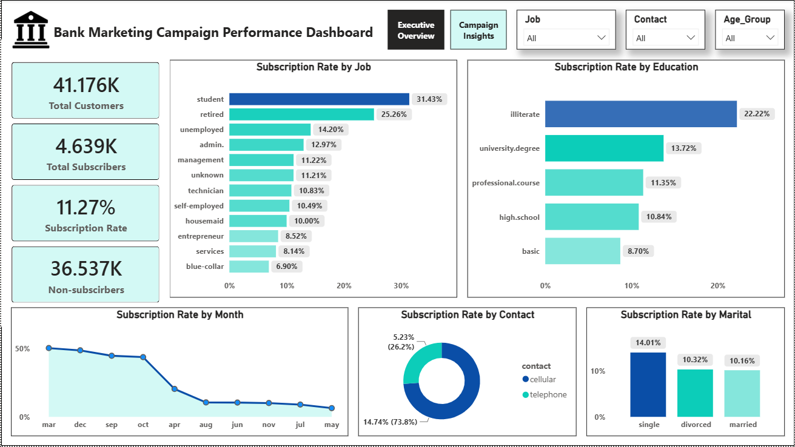
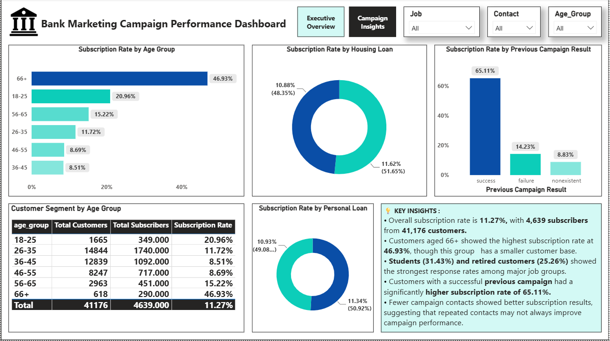

# 🏦 Bank Marketing Campaign Performance Analysis

### End-to-End Data Analytics Project

An end-to-end Data Analytics project that analyzes a bank's marketing campaign data to understand customer subscription behavior and identify patterns that can support better marketing decisions.

This project follows a complete analytics workflow using **Python for data preparation, MySQL for business analysis, and Power BI for interactive dashboard reporting**.

---

# 📌 Project Overview

Banks run marketing campaigns to encourage customers to subscribe to financial products such as term deposits. However, customer responses vary based on customer characteristics, contact methods, and previous campaign outcomes.

This project transforms raw bank marketing data into meaningful business insights. The analysis focuses on customer segments, campaign performance, contact methods, previous campaign results, and subscription patterns.

---

# 🎯 Business Problem

A bank wants to improve the effectiveness of its marketing campaigns and better understand which customer groups are more likely to subscribe.

The business wants to answer:

- Which customer groups have higher subscription rates?
- Which job categories respond better to marketing campaigns?
- How does age relate to subscription behavior?
- Does the contact method affect customer response?
- How do previous campaign results relate to current subscriptions?
- Does contacting customers multiple times improve campaign performance?

### Main Business Question

> **How can the bank use customer and campaign data to identify subscription patterns and support better targeting for future marketing campaigns?**

---

# 🛠️ Technology Stack

| Technology | Purpose |
|---|---|
| Python | Data preparation and quality checks |
| Pandas | Data manipulation and transformation |
| MySQL | Business analysis using SQL |
| SQL | Answering business questions |
| Power BI | Interactive dashboard development |
| DAX | KPI and business calculations |
| AI Tools (ChatGPT / Claude / Gamma) | Supporting productivity, documentation, presentation preparation, and project planning |
| GitHub | Project documentation and portfolio delivery |

---

# 🔄 Project Workflow

```text
Raw Dataset
     ↓
Python Data Preparation
     ↓
Cleaned Dataset
     ↓
MySQL Business Analysis
     ↓
Power BI Dashboard
     ↓
Insights & Recommendations
```

---

# 📊 Dataset Summary

The project uses a public bank marketing dataset containing customer information and marketing campaign details.

| Metric | Value |
|---|---:|
| Total Customer Records | 41,176 |
| Original Columns | 21 |
| Total Subscribers | 4,639 |
| Overall Subscription Rate | 11.27% |

### Key Data Areas

- Customer age
- Job
- Education
- Marital status
- Housing loan
- Personal loan
- Contact method
- Campaign contacts
- Previous campaign result
- Economic indicators
- Customer subscription outcome

Additional analysis-ready columns were created during data preparation.

---

# 🐍 Data Preparation Using Python

The dataset was reviewed and prepared before business analysis.

### Activities Performed

- Reviewed dataset structure and data types
- Checked missing and unknown values
- Identified duplicate records
- Created customer age groups
- Created a numeric subscription indicator
- Prepared the dataset for SQL and Power BI analysis

The goal was not to change the meaning of the original data, but to make it easier to analyze and report.

---

# 🗄️ SQL Business Analysis

The cleaned dataset was imported into MySQL for business analysis.

SQL was used to analyze:

- Overall subscription performance
- Subscription rate by job
- Subscription rate by age group
- Subscription rate by education
- Contact method performance
- Marital status patterns
- Previous campaign performance
- Campaign contact frequency

### SQL Skills Demonstrated

- SELECT
- WHERE
- GROUP BY
- CASE WHEN
- Aggregate functions
- Business calculations

Each analysis was performed to answer a meaningful business question and support the final dashboard insights.

---

# 📊 Power BI Dashboard

The final Power BI dashboard contains **two interactive pages** designed for business reporting.

## 📈 Executive Overview

Provides a high-level view of overall campaign performance.

### Key KPIs

- Total Customers
- Total Subscribers
- Subscription Rate
- Non-Subscribers

### Analysis Areas

- Subscription Rate by Job
- Subscription Rate by Education
- Subscription Rate by Month
- Subscription Rate by Contact Method
- Subscription Rate by Marital Status



---

## 📊 Customer & Campaign Insights

Provides a deeper analysis of customer segments and campaign performance.

### Analysis Areas

- Subscription Rate by Age Group
- Subscription Rate by Housing Loan
- Subscription Rate by Personal Loan
- Previous Campaign Result vs Current Subscription
- Customer Segments by Age Group
- Key Business Insights

> **Note:** Rename your second dashboard image to `Bank_Marketing_Campaign_Insights.png` in GitHub for a clean filename, then use the image link below.



---

# 📈 Key Results

| KPI | Result |
|---|---:|
| Total Customers | 41,176 |
| Total Subscribers | 4,639 |
| Subscription Rate | 11.27% |
| Non-Subscribers | 36,537 |

---

# 💡 Key Business Insights

- The overall subscription rate was **11.27%**, with **4,639 subscribers** from **41,176 customers**.

- Customers aged **66+** showed the highest subscription rate at **46.93%**, although this group has a smaller customer base.

- **Students and retired customers** showed strong subscription response rates among major job groups.

- Customers with a **successful previous campaign result** had a significantly higher current subscription rate of **65.11%**.

- Lower campaign contact frequency showed better subscription results, suggesting that repeated contacts may not always improve campaign performance.

> **Note:** These findings show patterns in the available data and should not be treated as proof that a specific customer characteristic directly causes a subscription decision.

---

# 💼 Business Recommendations

### 1. Improve Customer Targeting

Focus more attention on customer segments that consistently show stronger response rates.

### 2. Use Previous Campaign History

Use previous campaign outcomes to support better customer targeting in future campaigns.

### 3. Review Repeated Customer Contacts

Test more targeted follow-up strategies instead of repeatedly contacting the same customers.

### 4. Use Customer Segmentation

Consider different marketing approaches for different customer groups based on their response patterns.

---

# 📊 Skills Demonstrated

### Data Preparation

- Data Quality Checks
- Data Cleaning
- Data Transformation
- Feature Creation

### SQL Analysis

- Data Analysis
- Aggregate Functions
- GROUP BY
- CASE WHEN
- Business Calculations

### Power BI

- Data Transformation
- DAX Measures
- KPI Cards
- Interactive Dashboards
- Slicers and Filters
- Business Storytelling

### Professional Workflow

- Business Problem Understanding
- Data Preparation
- Business Analysis
- Dashboard Development
- Insights and Recommendations
- Project Documentation

---

# 📁 Repository Structure

```text
Bank-Marketing-Campaign-Performance-Analysis/
│
├── Bank_Marketing_Dashboard.pbix
├── Bank_Marketing_analysis.sql
├── bank_Raw_dataset.csv
├── bank_marketing_cleaned_dataset.csv
├── data_understanding_Cleaning.ipynb
│
├── Bank_Marketing_Executive_Dash.png
├── Bank_Marketing_Campaign_Insights.png
│
├── Bank_Marketing_Business_Problem_Document.pdf
├── Bank_Marketing_User_Guide.docx
├── Bank_Marketing_Developer_Handover_Guide.docx
│
└── README.md
```

---

# 🚀 How to Run the Project

## Step 1 — Download the Dataset

Keep the original dataset available for reference.

The cleaned dataset created during the project is used for SQL analysis and Power BI reporting.

---

## Step 2 — Run Python Data Preparation

Install the required Python package:

```bash
pip install pandas
```

Open and run:

```text
data_understanding_Cleaning.ipynb
```

The notebook reviews and prepares the data for further analysis.

---

## Step 3 — Run SQL Analysis

1. Open MySQL.
2. Create or select the project database.
3. Import the cleaned dataset.
4. Open and run:

```text
Bank_Marketing_analysis.sql
```

5. Review the query results and business insights.

---

## Step 4 — Open the Power BI Dashboard

1. Open:

```text
Bank_Marketing_Dashboard.pbix
```

2. Update the data source if required.
3. Refresh the dataset.
4. Use the slicers to explore different customer segments and campaign patterns.

---

# 📚 Project Documentation

This repository includes supporting project documentation.

### 📄 Business Problem Document

Explains the business situation, business problem, objectives, stakeholder questions, and project deliverables.

### 👤 User Guide

Explains how a new user can understand, open, and use the project files and dashboard.

### 🛠️ Developer Handover Guide

Provides technical information about the project workflow, files, data preparation, SQL analysis, dashboard development, and future maintenance.

---

# 🔮 Future Improvements

Possible future enhancements include:

- Adding campaign cost and revenue data to calculate marketing ROI.
- Including more detailed customer segmentation.
- Adding automated data refresh.
- Comparing campaign performance across different time periods.
- Testing predictive models for subscription probability.

---

# 👨‍💻 Developed By

**Anil Kumar**

Aspiring Data Analyst | Python | SQL | Power BI | Excel

GitHub: https://github.com/thandaanil987

LinkedIn: https://linkedin.com/in/thanda-anil-kumar-5817172a5

---

## ⭐ Project Summary

This project demonstrates an end-to-end Data Analytics workflow by transforming raw marketing campaign data into meaningful business insights.

**Python → MySQL → Power BI → Insights → Business Recommendations**

The project focuses on using customer and campaign data to understand subscription patterns and support better marketing decisions.
